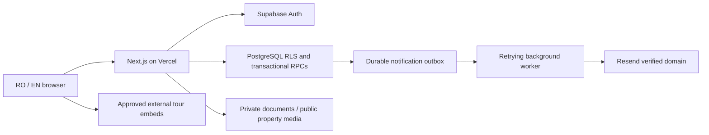

# Architecture, workload and capacity

The MVP serves six physical properties with twelve linked sale/rent listings. An own or invited property is seed inventory, not an external paying customer. The primary correctness boundary is the physical property; every competing bid/reservation/lifecycle mutation locks it first. See ADRs for privacy and transaction contracts.

The outbox/worker box is an operating requirement; verify the implemented delivery adapter and scheduler before enabling production notifications. Financial counterparties are outside this architecture until contracted and verified.

## Explicit workload assumptions

These are planning scenarios, not observed traffic or provider guarantees. One WAU performs three sessions/week and views ten listing pages/session; average page/API work is three server requests per view. Each property has 12 optimized 300 KB photos (3.6 MB/property). Five visible photos/page average 1.5 MB; use responsive lazy loading and CDN caching. A tour is an external embed: its video/3D traffic and plan limits belong to that provider and are excluded from app media calculations. Private legal documents are assumed 5 MB/property, segregated with authorization and retention controls.

| Planning point | Under-500 case | 500+ base case | Stress case |
| --- | ---: | ---: | ---: |
| WAU | 400 | 2,500 | 10,000 |
| Listing views/week | 12,000 | 75,000 | 300,000 |
| Server requests/week | 36,000 | 225,000 | 900,000 |
| Average server requests/sec | 0.06 | 0.37 | 1.49 |
| Assumed peak/average multiplier | 30× | 30× | 30× |
| Planning peak requests/sec | 1.8 | 11.2 | 44.6 |
| Uncached photo transfer/week | 18 GB | 112.5 GB | 450 GB |
| Hypothetical 90% CDN hit: origin photo transfer/week | 1.8 GB | 11.25 GB | 45 GB |

Auction closing traffic can be far more concentrated on one property than these averages: load test hot-property contention separately. CDN hit ratio is an assumption, not a bill estimate. At 1,000 properties photo originals/variants need an explicit retention/storage budget; 3.6 GB is only this simplified optimized-photo copy, not originals, backups or tours. Database assumptions: 2% of listing views cause one durable mutation, yielding 240 / 1,500 / 6,000 mutation transactions/week before messages and retries. Index by property/listing, state and time; paginate messages and owner workspaces. Profile authorization queries under realistic data volumes.

## Below 500 WAU

Use a single Next.js app, one Supabase project per environment, indexed relational tables and simple scheduled outbox delivery. Cache public catalogue reads while keeping authenticated/exact-address/confidential responses private and uncached. Explicitly cap image dimensions, upload bytes, pagination and request rates. Keep database transactions short; never send email while holding a property lock. Track p95 request latency/error rates, slow queries, lock wait time, Auth errors, disk/egress costs and outbox age.

## 500+ WAU with 2,500 base / 10,000 stress

The same APIs and schema remain. Increase database compute only after analyzing query plans/connection utilization; use a provider-supported transaction pooler for stateless traffic where compatible and a direct/session connection for migrations. Add indexes with lock-aware migrations, apply read caching to public catalogue projections, move notification delivery and media processing into idempotent workers, and enforce upload/retention/egress budgets. Tour providers scale independently through commercial plans. Evaluate read replicas/search service only if measured query mix needs them; security-sensitive reads retain clear consistency/authorization rules.

No rebuild boundary sits at 500 users. Trigger an architectural change when measured SLOs or cost ceilings fail under the 10,000-WAU scenario after tuning, or when a hot property cannot meet the transactional latency target. Define and benchmark those targets before launch; a spreadsheet does not demonstrate capacity. Never trade a serialized ownership decision for eventually consistent correctness.

## Reliability and security operations

Migrations, pgTAP RLS tests, two-session concurrency tests and real Auth/browser checks gate releases. Clock decisions use server time after lock acquisition; idempotency and conflict codes are shared across linked listings. Capture error IDs and timing without private bids/documents in logs. Monitor failed jobs, retries and dead letters. Document deletion/export/retention workflows and access audit controls before collecting sensitive production documents. Exercise restores and configure PITR before live funds. Keep incident, rollback and data-repair procedures separate; do not automatically reverse a database after a failed deployment.

Official technical references: [Supabase RLS](https://supabase.com/docs/guides/database/postgres/row-level-security), [PostgreSQL explicit locking](https://www.postgresql.org/docs/current/explicit-locking.html), [Supabase connection methods](https://supabase.com/docs/guides/database/connecting-to-postgres), [Vercel observability](https://vercel.com/docs/observability), [Supabase regions](https://supabase.com/docs/guides/platform/regions).
