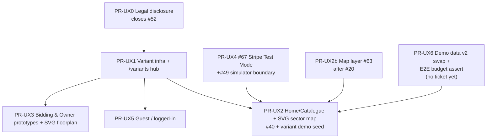

# LicitatieRO — UX variant architecture blueprint

Documentation-only reference for multi-variant UX rollout.

**Scope split (required):**

- **Variant-scoped:** Visual re-skin only — `:root[data-variant]` tokens, layout slots, density and typography. Default selection is **`classic`** when no query param is set.
- **All variants including `classic`:** **PR-UX0** legal/POC disclosure layer — always-on `.poc-banner`, qualified `sold`/`rented`/`signed` labels, bid/offer acknowledgement checkboxes, signup legal acceptance, `/legal/{terms,privacy,cookies}`, click-to-load embed consent, Stripe test-mode banners. Implementing UX0 **will** change `classic` UI copy and banners; update E2E expectations in the same PR (e.g. `authenticated.spec.ts` label assertions), not in a follow-up.

---

## Core UX philosophy & hard constraints

### Phone-first → desktop-advanced

| Layer | Requirement |
| --- | --- |
| **Mobile baseline** | `375px` native ergonomics; `min-width` media queries only (no desktop-first breakpoints that break narrow viewports). Zero broken grids or horizontal clipping. Primary actions in thumb reach. Filters and secondary flows via bottom sheets where appropriate. |
| **Desktop (`≥1024px`)** | Fully functional advanced workspace: split map + catalogue, dense `€/m²` comparison tables, multi-column bidder/owner operations. |
| **Philosophy** | Phone-first baseline, fully functional and advanced on desktop (Florentin, 14 Nov 2026). |

### Product & compliance constraints

- **Zero live money** — every financial flow labeled **POC / Simulare**; **deposits and reservation holds remain disabled** (simulation-only; no wallet or escrow).
- **$0 extra SaaS cost** for variant infrastructure (cookie + localStorage + scoped CSS; no paid A/B vendors required for POC).
- **RO default + EN toggle** — bilingual copy and routing preserved.
- **Light / Dark / System** themes — variant tokens must compose with existing theme switching.

---

## Non-destructive multi-variant architecture

### Selection & persistence

```
?variant=a|b|c|classic
```

- Persisted to **cookie** and **`localStorage`** key `licitatiero-variant`.
- Mirrored on **`<html data-variant="...">`** for CSS and integration tests.
- **Consent:** No automatic A/B assignment without opt-in (ePrivacy art. 5(3) / RO Law 506/2004). User-explicit choice via banner or `/variants` is required. Document the storage key in the cookie notice tracked by **[#70](https://github.com/LicitatieRO/marketplace/issues/70)** (blocked on controller identity).

### Discovery & preview

- **`VariantSwitcherBanner`** — floating, non-blocking switcher on POC surfaces.
- **`/variants` hub** — side-by-side previews, pros/cons per variant, viewer-state toggles: **guest**, **buyer**, **owner**.

### Implementation pattern (minimal DOM surgery)

- Scoped **`:root[data-variant=x]`** CSS token overrides and **slot components** for visual/layout divergence.
- Preserve existing DOM nodes and **ARIA hooks** where possible; UX0 legal components are **cross-cutting** and apply regardless of variant.

---

## GitHub issue map (real tickets)

Use this table when claiming work — do not re-open scopes already owned by an issue.

| Blueprint slice | GitHub issue | Title (abbrev.) |
| --- | --- | --- |
| PR-UX0 legal / POC / embed consent | **[#52](https://github.com/LicitatieRO/marketplace/issues/52)** | Mandatory POC/Simulare disclosures and consent-gated embed hardening — **PR-UX0 implements and closes** |
| PR-UX0 cookie / privacy copy | **[#70](https://github.com/LicitatieRO/marketplace/issues/70)** | Privacy, cookie notice, POC terms (controller identity **blocked**) |
| PR-UX2 sectors / coordinates | **[#40](https://github.com/LicitatieRO/marketplace/issues/40)** | Bucharest sector & neighborhood filters, map-ready coordinates (no paid map keys) |
| PR-UX2b map layer (post-Node upgrade) | **[#63](https://github.com/LicitatieRO/marketplace/issues/63)** | MapTiler/Leaflet behind feature flag — **not** a second consent implementation (#52 owns consent) |
| Platform prerequisite for PR-UX2b | **[#20](https://github.com/LicitatieRO/marketplace/issues/20)** | Node 26 LTS + dependency/Playwright CI upgrades |
| Tour embed commercial polish (phase 2) | **[#62](https://github.com/LicitatieRO/marketplace/issues/62)** | Kuula/Matterport UX polish — blocked; consent already in #52 |
| PR-UX4 promotion preview (no Stripe) | **[#49](https://github.com/LicitatieRO/marketplace/issues/49)** | Property promotion **simulator** ($10/7-day preview, **no** Stripe SDK/keys) |
| PR-UX4 Stripe Test checkout | **[#67](https://github.com/LicitatieRO/marketplace/issues/67)** | Stripe Test/Sandbox **€10/7-day** checkout (zero real charges) — implementation home for PR-UX4 |
| Live Stripe checkout (out of UX scope) | **[#60](https://github.com/LicitatieRO/marketplace/issues/60)** | Founder-gated live checkout — **blocked** / deferred; do **not** implement in PR-UX4 |
| Variant infra, `/variants` hub, guest auth UX | *no ticket yet* | |
| Demo data v2 variant-only seed + production swap | *no ticket yet* | |
| `marketplace.spec.ts` Actions budget assertion (PR-UX6) | *no ticket yet* (related policy: [#15](https://github.com/LicitatieRO/marketplace/issues/15) selective CI) | |

---

## Three variants × four core surfaces

### Variant A — Editorial Bucharest

**Tone:** Warm architectural palette, serif headings, generous whitespace, curated narrative cards.

| Pros | Cons |
| --- | --- |
| High emotional trust for high-value residential; strong brand identity | Lower information density on desktop comparison unless tables expand or toggle to dense mode |

### Variant B — Auction Terminal

**Tone:** Crisp fintech aesthetic, high-density data, `€/m²` and yield metrics; keyboard/tabular comparison on desktop; **stacked mobile-safe cards at `375px`** — never crush 8-column tables onto narrow phones.

| Pros | Cons |
| --- | --- |
| Fastest multi-lot scanning; transparent auction pricing | Can feel clinical for casual renters if mobile balance is neglected |

### Variant C — Bento Discovery

**Tone:** Mobile-native cards, thumb-zone filters, bottom sheets; asymmetric **bento grid** on desktop.

| Pros | Cons |
| --- | --- |
| Best `375px` one-handed UX; fast discovery | Less suited for dense institutional bidding on desktop unless paired with expandable detail panes |

---

### Surface 1 — Homepage & catalogue

**All variants (visual).** Bucharest-focused catalogue with sector map (SVG in variant rollout; interactive map layer follows **#63** after **#20**).

**Benchmark zones** (labelled **preț cerut** — illustrative POC data). Each row is **total asking price (EUR)** and **asking price per square metre (EUR/m²)** for a representative listing in that zone:

| Zone | Total ask (EUR) | Ask (EUR/m²) |
| --- | ---: | ---: |
| Floreasca | 249,000 | 750 |
| Pipera (Voluntari, Ilfov) | 320,000 | 1,150 |
| Unirii | 215,000 | 650 |
| Tineretului | 195,000 | 750 |
| Drumul Taberei | 104,000 | 450 |
| Cotroceni | 275,000 | 1,050 |

Align filter labels and seed coordinates with **#40** when demo/catalogue data is updated.

---

### Surface 2 — Simulated bidding & confidential offers

**All variants.** POC rules surfaced in UI (engine work remains under Epic **#22**; e.g. **#35** anti-sniping, **#37** sealed offers):

- Sealed-bid / confidential offer protection copy.
- Quick-bid chips (mobile thumb zone).
- Countdown and anti-sniping rules (simulated timers; **no live settlement**).

---

### Surface 3 — Owner console & dual sale/rent listing wizard

**All variants.**

- Shared **property core** + dual **sale** / **rent** child listings (see **#46** mutual-exclusion guardrails).
- Single **promo charge** in POC: **€10 EUR per physical property per 7 days** covers **both** linked sale and rent listings (one checkout per `property_id`).

---

### Surface 4 — Account & simulated promotion

**All variants.**

| Track | Issue | Behavior |
| --- | --- | --- |
| Cosmetic simulator | **#49** | No Stripe SDK, no keys; UI-only €/$ preview badge |
| Test checkout | **#67** | Stripe **Test Mode only** — `sk_test_` / `whsec_` (and matching publishable test key); **hosted Checkout** created via server-side REST **`fetch`** (no client-side Stripe.js requirement for the documented UX path) |

**#67 / PR-UX4 payment rules (PM decisions):**

- **Fail-closed:** Reject startup, checkout creation, and webhooks if any **`sk_live_` / `pk_live_`** is configured or if a webhook/event has **`livemode: true`**. Never treat success from return-URL query parameters alone.
- **Activation:** Promote a listing only after **`Stripe-Signature`** webhook verification (raw body + timestamp tolerance) **or** a server-side Checkout **Session** lookup — not from client return URLs.
- **Price:** **€10 EUR** per physical property per **7 days** (one charge covers sale + rent listings; never **$10** in product copy — see open decision on **#49** title vs EUR product).
- **Mock fallback:** When no test key is set, a **deterministic local mock** may run only in **local/staging**, must be **visibly labelled POC / Simulare**, and must be **disabled in production** (no fake successful payments per [`docs/third-parties.md`](../third-parties.md)).
- **Out of scope:** **#60** live founder-gated checkout stays blocked.

Promotion checkout is **logged-in owners only** (**#67**).

---

## Cross-cutting legal & guest/logged-in layers

### Legal (`PR-UX0` → closes **#52**)

| Element | Behavior |
| --- | --- |
| **`.poc-banner`** | Always on for every variant including **`classic`** (even when Supabase is configured); preserve **`.demo-banner`** test hooks where existing selectors depend on them. |
| **Status labels** | Qualified `sold` / `rented` / `signed` — non-notarial wording. |
| **Confirmation copy** | e.g. *"Confirm în platformă un semn formal simulat (nu este act notarial)"* |
| **Bids/offers** | No-money banners + required acknowledgement checkboxes. |
| **Signup** | Acceptance flows + `/legal/{terms,privacy,cookies}`. |
| **Embeds** | **OpenStreetMap/Leaflet** and **Kuula/Matterport** load **only after explicit click-to-load consent** — **no network requests and no iframes** before consent. Consent implementation is **#52**; **#62** / **#63** add phase-2 polish/flags only. |
| **Stripe** | Banner: **TEST MODE — Nu se percepe nicio taxă reală**. |
| **E2E** | Update `authenticated.spec.ts` (and related) disclosure copy expectations in **PR-UX0**, including for **`classic`**. |

### Guest vs logged-in (`PR-UX5`)

| Topic | Behavior |
| --- | --- |
| **Browsing** | Public everywhere variants apply. |
| **Auth gates** | Gentle, non-blocking; allow-listed **`safe-next`** + **`intent=`** (never auto-submit money or bid intents). |
| **Role** | Active role pill: **Cumpărător** / **Proprietar**. |
| **Account hygiene** | Staging verification/outbox hint; clean **Sign out** / **Switch account**. |
| **GitHub** | *no ticket yet* |

---

## 8-PR sequencing plan



| PR | Scope | GitHub / dependencies |
| --- | --- | --- |
| **PR-UX0** | Legal disclosure layer | **Implements and closes [#52](https://github.com/LicitatieRO/marketplace/issues/52)**; cookie notice text coordinated with **[#70](https://github.com/LicitatieRO/marketplace/issues/70)**; E2E copy updates in same PR |
| **PR-UX1** | Variant infra + `/variants` hub | *no ticket yet* — after UX0 |
| **PR-UX5** | Guest/logged-in | *no ticket yet* — parallel with UX2/UX3 after UX1 |
| **PR-UX2** | Home/catalogue + SVG sector map; variant-only demo seed | **[#40](https://github.com/LicitatieRO/marketplace/issues/40)**; parallel with UX3/UX5 |
| **PR-UX3** | Bidding & owner prototypes + SVG floorplan | Epic **[#22](https://github.com/LicitatieRO/marketplace/issues/22)** prototypes; parallel with UX2/UX5 |
| **PR-UX4** | Stripe Test Mode checkout + mock | **[#67](https://github.com/LicitatieRO/marketplace/issues/67)** (implementation); **[#49](https://github.com/LicitatieRO/marketplace/issues/49)** stays no-SDK simulator; **not [#60](https://github.com/LicitatieRO/marketplace/issues/60)** |
| **PR-UX2b** | Interactive map layer | After **[#20](https://github.com/LicitatieRO/marketplace/issues/20)** merges; implements flag path per **[#63](https://github.com/LicitatieRO/marketplace/issues/63)** — consent remains **#52** |
| **PR-UX6** | Demo data v2 default swap + `marketplace.spec.ts` budget assertion | *no ticket yet*; seed alignment with **#40** where sectors matter; not blocked on **#40** for unrelated concerns (e.g. `email_verified`) |

---

## Open decisions

| Topic | Status |
| --- | --- |
| **#49 title vs product currency** | Issue text uses **$10**; product/UX uses **€10 EUR** — reconcile issue copy and economics docs in a dedicated docs or #49 update (open). |
| **`licitatiero-variant` storage** | Cookie notice + legal bases in **[#70](https://github.com/LicitatieRO/marketplace/issues/70)** once controller identity is recorded — no invented controller fields. |
| **`email_verified` staging flows** | *no ticket yet* — do **not** track under **#40** (sector filters). Coordinate with delivery/staging issues when a ticket exists. |
| **Controller legal identity** | **[#70](https://github.com/LicitatieRO/marketplace/issues/70)** stays blocked until founder records controller identity. |

---

## Related documentation

- Repo index: [README.md](./README.md)
- Agent handoff: [docs/AI_HANDOFF.md](../AI_HANDOFF.md)
- Provider boundaries: [docs/third-parties.md](../third-parties.md)
- Internal Canvas prototype and 716-line Grok Library spec — see [README.md](./README.md) (not committed to this repo)